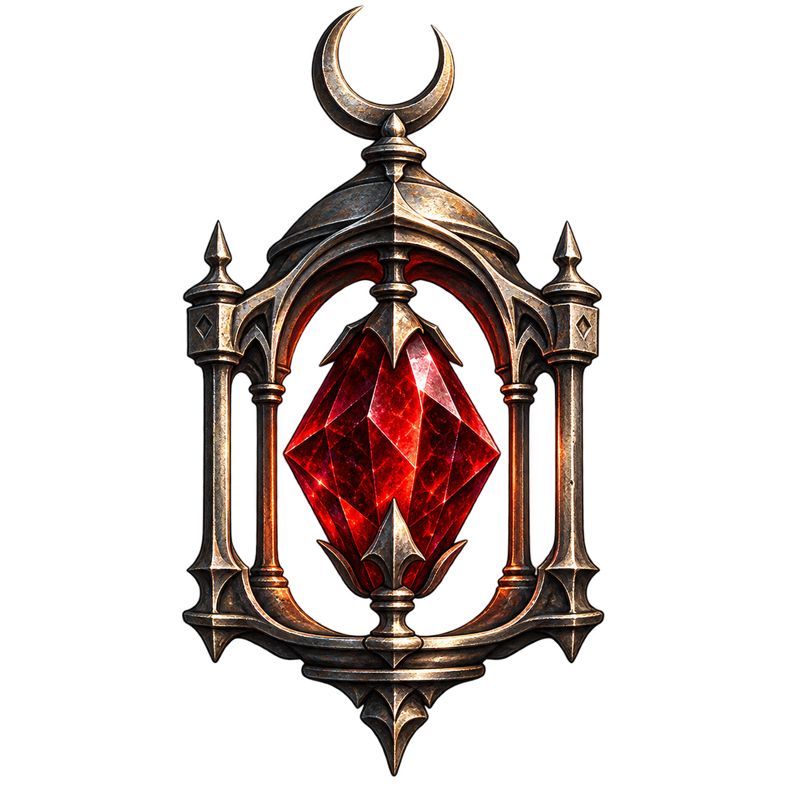
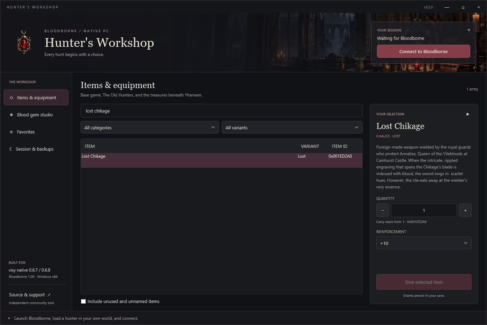
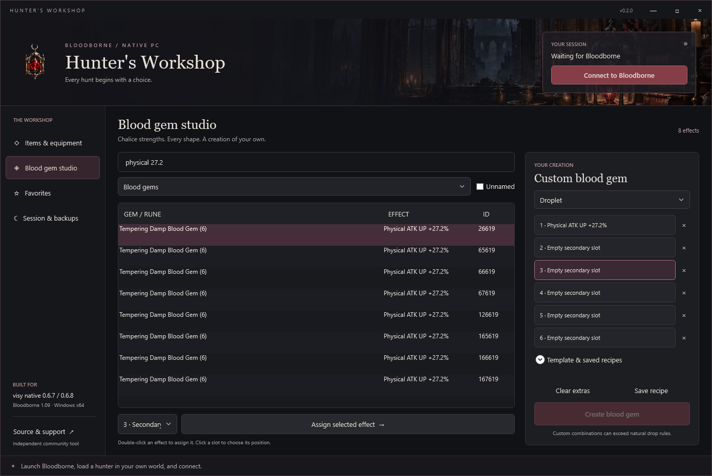

<p align="center"></p>

# Hunter's Workshop

A standalone item spawner and blood gem studio for the **visy Bloodborne native Windows port**. Find equipment, build gems, save recipes, and keep verified recovery snapshots in one gothic desktop app.

**[Download the Windows app](https://github.com/SpetsTheWise/bloodborne-hunters-workshop/releases/latest)** · [Report a problem](https://github.com/SpetsTheWise/bloodborne-hunters-workshop/issues/new/choose) · [Testing details](TESTING.md)



## Compatibility

Windows 10/11 x64 with .NET Framework 4.8, Bloodborne **1.09**, and the exact official **visy 0.6.7 or 0.6.8** Windows executable. These builds are checked by SHA-256 before attaching; the game functions are checked in memory too. The folder name can differ from the installed version.

This release targets the native port. shadPS4, other forks, modified executables, other game versions, and unknown future builds require separate compatibility work. A mismatch produces an explanation and refuses attachment.

| Port | Supported `out/bbport.exe` SHA-256 |
| --- | --- |
| visy 0.6.7 | `dee03f24a60672502a24f4b79340ec7245e9a01a51eef54390a7f6fa5e61a706` |
| visy 0.6.8 | `dc580f45763c10af608060c6d97d5ec6584a110ecb9dc4eb3ec210f4c0fe7b8a` |

## What you can create

- **402 named item entries**: 97 weapons, 126 armor pieces and 179 goods, with base game and The Old Hunters content.
- All **26 Lost and 26 Uncanny weapon variants**, including chalice and DLC weapons. Choose an existing reinforcement from +0 through +10.
- Consumables, upgrade materials, keys, chalices and ritual materials, with per-item quantity limits.
- **12,485 named blood gem effect rows** and **82 named Caryll rune rows**, including chalice strengths, secondary effects and curses.
- Radial, triangle, waning, circle and droplet gems. Six independent effect slots, source template selection, standard and oath runes, and persistent recipes.
- Favorites, multiword search, decimal/hex item IDs and optional unused/unnamed parameter entries. The complete catalog contains 763 item entries and 16,101 effect rows.

Gems are constructed from parameter effects rather than a list of every possible procedural drop. Custom combinations can exceed natural drop rules. The advanced catalog includes unused content whose models or behavior may be incomplete. Possessing a key or chalice does not set its associated quest or world flags.



## Start using it

1. Download the release ZIP and extract it anywhere you can write files. Run `HuntersWorkshop.exe`; no installer, Python, game files or separate catalog downloads are needed.
2. Launch Bloodborne normally and load a living character in your own world. Your usual native launcher or Steam shortcut works.
3. Click **Connect to Bloodborne**. Wait for **Hunter ready**.
4. Choose an item, quantity and reinforcement, then **Give selected item**. For gems, assign a primary effect and any extras, choose a shape, then **Create blood gem**.

The first grant for a loaded character creates a verified backup. Manual backups are in **Session & backups**. Grants persist in the game's save. Use your own world or host session; grants are refused while summoned as a guest, dead or loading. Multiplayer synchronization with other players has not been validated.

No administrator access is requested. If your game runs elevated, run both programs at the same permission level. The executable is unsigned. Releases include SHA-256 checksums and the complete GPL source.

## Backups and recovery

Preferences, recipes, logs and backups live under `%LOCALAPPDATA%\HuntersWorkshop`, outside the game installation. The running game's `--user` argument is used to locate its saves. You can choose the native port folder for a manual backup while the game is closed; that uses the detected save location or the port's default `user` directory.

Snapshots include both `savedata` and `savedata_party`, skip unfinished `.bbtmp` files, reject symbolic links/junctions, and include file sizes and SHA-256 hashes in `manifest.json`. The complete source file list and hashes are checked again before the snapshot is published. A running-game snapshot is a best-effort disk copy; **make a manual backup with the game closed for the strongest recovery point**.

To restore: close Bloodborne, keep a separate copy of your current saves, then copy the chosen snapshot's `savedata` and/or `savedata_party` directories into the **Source** directory recorded in its manifest. Preserve the folder names. The app does not restore saves automatically.

If a command times out or its outcome is uncertain, restart Bloodborne and inspect inventory and storage before repeating it. Automatic retries are deliberately disabled.

## Shortcuts

| Action | Shortcut |
| --- | --- |
| Focus the current search | Ctrl+F |
| Favorite the selected item | Ctrl+D |
| Assign an effect | Double-click it, or use Assign selected effect |
| Choose an effect slot | Click the slot |

## Build and verify

On Windows, clone this repository and run:

```powershell
.\build.ps1
.\dev\verify.ps1
.\package.ps1
```

The app builds with the Windows .NET Framework C# compiler; no NuGet restore or SDK is required. Python with the pinned development dependency is used only for additional bridge tests. See [DEVELOPMENT.md](DEVELOPMENT.md) for architecture, reproducible checks, and the explicitly opt-in copied-save integration fixture.

## Credits and license

GPL-3.0-or-later. Built on the research and source of [visy's Windows native port](https://github.com/visy/bloodborne_pc_windows_port) and catalog work from [Noxde's Bloodborne save editor](https://github.com/Noxde/Bloodborne-save-editor). Exact source revisions and adaptation details are in [THIRD_PARTY_NOTICES.md](THIRD_PARTY_NOTICES.md). Original app artwork was generated with AI; prompts and asset details are in [ASSETS.md](ASSETS.md).

An independent community utility, unaffiliated with FromSoftware or Sony. No game executables, saves, textures, models or other game assets are included.
